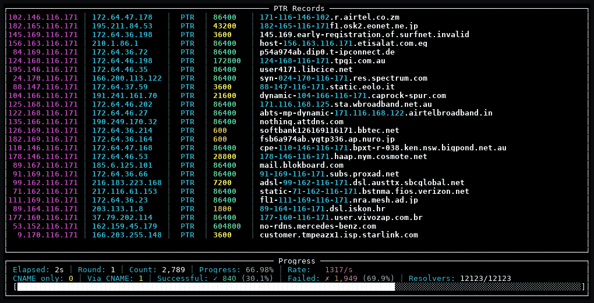

# PTRStream
> High-performance distributed PTR record scanner with real-time streaming output



PTRStream is a fast and efficient PTR record scanner designed for distributed scanning operations. It walks the IPv4 space with a counter whose octets are reversed *(the same order as massdns's `ptr.py`)*, so every IP is queried exactly once, consecutive queries land in different /8s, and work splits cleanly across multiple machines.

## Features

- Every IPv4 address exactly once, in octet-reversed order
- Distributed scanning support via sharding
- Queries go out in batches from 4 long-lived UDP sockets *(sendmmsg/recvmmsg)*, answers are only accepted from the resolver that was asked, for the question that was asked
- Real-time NDJSON output for streaming to data pipelines
- Support for both PTR and CNAME records
- Automatic DNS server rotation from public resolvers
- Failing resolvers are benched for 10 minutes after 20 failures in a row
- Resume from a state file, loop forever for 24/7 runs
- Exclude CIDRs from a file
- Progress tracking with detailed statistics
- Colorized terminal output
- CAIDA-style error formatting (with -debug flag)

## Installation

```bash
go install github.com/acidvegas/ptrstream@latest
```

## Options
| Flag       | Type       | Default | Description                                                     |
|------------|------------|---------|-----------------------------------------------------------------|
| `-c`       | `int`      | `10000` | Max lookups in flight                                           |
| `-debug`   | `bool`     | `false` | Show unsuccessful lookups                                       |
| `-dns`     | `string`   |         | File containing DNS servers *(default: trickest list, refreshed every 24h)* |
| `-exclude` | `string`   |         | File of IPv4 CIDRs or IPs to skip *(one per line, `#` comments)* |
| `-j`       | `bool`     | `false` | Output NDJSON to stdout *(no TUI)*                              |
| `-l`       | `bool`     | `false` | Loop continuously after completion                              |
| `-o`       | `string`   |         | Path to NDJSON output file                                      |
| `-rate`    | `int`      | `0`     | Max queries per second *(0 for unlimited)*                      |
| `-r`       | `int`      | `2`     | Retries on the next resolver for timeouts, SERVFAIL and REFUSED |
| `-shard`   | `string`   |         | Shard specification *(index/total format)*                      |
| `-state`   | `string`   |         | State file to resume from and save progress to                  |
| `-t`       | `duration` | `2s`    | Timeout for DNS queries                                         |
| `-stats-interval` | `duration` | `10m` | How often to log a stats line to stderr with `-j` *(0 to turn off)* |

## Usage

```bash
# Basic usage
ptrstream -o output.json

# Use specific DNS servers
ptrstream -dns resolvers.txt -o output.json

# Increase concurrency
ptrstream -c 20000 -o output.json

# Cap the query rate
ptrstream -rate 12000 -o output.json

# Distributed scanning (4 machines)
# Machine 1:
ptrstream -shard 1/4 -o shard1.json
# Machine 2:
ptrstream -shard 2/4 -o shard2.json
# Machine 3:
ptrstream -shard 3/4 -o shard3.json
# Machine 4:
ptrstream -shard 4/4 -o shard4.json
```

## Distributed Scanning

PTRStream supports distributed scanning through its sharding system. Each shard takes a contiguous slice of the counter, so by giving each instance a different shard specification you can distribute the workload across multiple machines while ensuring:

- No IP address is scanned twice
- Even distribution of work
- Deterministic results
- Queries spread across every /8 in octet-reversed order

For example, to split the work across 4 machines:
```bash
# Each machine uses a different shard
ptrstream -shard 1/4  # Machine 1
ptrstream -shard 2/4  # Machine 2
ptrstream -shard 3/4  # Machine 3
ptrstream -shard 4/4  # Machine 4
```

## Running 24/7

Use `-l` to start over when the shard is finished and `-state` to survive restarts:

```bash
ptrstream -j -l -shard 1/4 -state shard1.state -exclude reserved.txt
```

The state file is one line, written every 10 seconds and on SIGINT/SIGTERM:

```
shard=1/4 round=3 next=1834567890
```

`next` is the lowest position that still has an unfinished lookup *(tracked in blocks of 4,096 IPs)*, and output is flushed before the file is written, so a restart never skips an IP. Lookups that finished after that position are queried again, usually a few seconds of work. A state file for a different shard is refused. Starting on a state file whose round is finished begins the next round from the start of the shard, with or without `-l`.

## Excluding ranges

Nothing is skipped unless a file is passed with `-exclude`. [`reserved.txt`](./reserved.txt) lists the IPv4 ranges that are not on the public internet *(RFC 6890 special purpose, multicast and the old class E space)*. Resolvers answer those from their own local zones, mostly with `localhost`, so they are not real data. Round 1 of the full IPv4 space got about 64,000 of these answers.

## Stats line

With `-j`, every `-stats-interval` a line goes to stderr with the rates over that interval and what every finished IP ended with, as a share of all IPs finished in it *(the shares add up to 100%, the numbers below are only an example)*:

```
stats round=1 progress=1.006% next=43216647 elapsed=10m0s ips/s=7950 ptr/s=2350 queries/s=12000 retries/s=4050 ptr=29.6% nxdomain=38.2% servfail=6.1% refused=1.9% noptr=19.7% timeout=4.5% other=0.0% lookups=4769985 queries=7200000 resolvers=5857/12123
```

`-rate` caps `queries/s`, retries included, so `ips/s` is lower when many lookups need retries. The TUI shows the same numbers live, so the line is off without `-j`.

## Output

Results are NDJSON *(one JSON record per line)* on stdout with `-j` and in a file with `-o`, ready for any data pipeline. Each record has:

| Field         | Description                                                     |
|---------------|-----------------------------------------------------------------|
| `@timestamp`  | Timestamp *(RFC 3339)*                                          |
| `ip`          | IP address                                                      |
| `nameserver`  | Resolver that answered                                          |
| `record`      | Array of PTR names, or the `FAIL.` error name *(left out for a CNAME with no PTR behind it)* |
| `record_type` | `PTR`, `CNAME` or `ERR`                                         |
| `cname`       | CNAME target in the answer *(the RFC 2317 delegation a PTR was reached through, or the whole answer for `record_type` CNAME)* |
| `ttl`         | TTL of the answer                                               |

## CNAME Support

Classless reverse delegation *(RFC 2317)* answers with a CNAME followed by the PTR it points to. PTRStream records that as a `PTR` with the CNAME target in `cname`. A CNAME with no PTR behind it is recorded as `CNAME` with no `record` and the target in `cname`, so `cname` always means the CNAME target.

```json
{"@timestamp":"2026-11-16T02:17:37-05:00","ip":"195.53.95.8","nameserver":"1.1.1.1","record":["8.red-195-53-95.customer.static.ccgg.telefonica.net"],"record_type":"PTR","cname":"8.0.95.53.195.in-addr.arpa","ttl":86400}
{"@timestamp":"2026-11-16T02:17:37-05:00","ip":"151.41.96.70","nameserver":"8.8.8.8","record_type":"CNAME","cname":"41.151.in-addr.arpa","ttl":3600}
{"@timestamp":"2026-11-16T02:17:37-05:00","ip":"70.48.177.180","nameserver":"1.1.1.1","record":["bras-base-wtbyon9417w-grc-11-70-48-177-180.dsl.bell.ca","bras-base-toroon01zb4-grc-37-70-48-177-180.dsl.bell.ca"],"record_type":"PTR","ttl":86400}
```

## Debug Mode

When running with `-debug`, failed lookups are displayed and logged using CAIDA-style error formatting. Each error is represented as a special `.in-addr.arpa` address:

```
2024-01-05 12:34:56 │ 1.2.3.4     │ 8.8.8.8        │  ERR  │        │ FAIL.TIMEOUT.in-addr.arpa
2024-01-05 12:34:57 │ 5.6.7.8     │ 1.1.1.1        │  ERR  │        │ FAIL.SERVER-FAILURE.in-addr.arpa
2024-01-05 12:34:58 │ 9.10.11.12  │ 8.8.4.4        │  ERR  │        │ FAIL.NXDOMAIN.in-addr.arpa
```

Error types include:
- `FAIL.TIMEOUT.in-addr.arpa` - DNS query timed out
- `FAIL.SERVER-FAILURE.in-addr.arpa` - DNS server returned SERVFAIL on every attempt
- `FAIL.NXDOMAIN.in-addr.arpa` - No PTR zone exists for the IP *(NXDOMAIN)*
- `FAIL.REFUSED.in-addr.arpa` - Query was refused on every attempt
- `FAIL.NO-PTR-RECORD.in-addr.arpa` - NOERROR with no PTR record *(NODATA)*
- `FAIL.CONNECTION-REFUSED.in-addr.arpa` - Resolver port closed *(ICMP port unreachable)*
- And more...

These errors are also included in the NDJSON output when using `-debug` with either `-o` or `-j`:
```json
{"@timestamp":"2024-01-05T12:34:56Z","ip":"1.2.3.4","nameserver":"8.8.8.8","record":["FAIL.TIMEOUT.in-addr.arpa"],"record_type":"ERR","ttl":0}
```

___

###### Mirrors: [acid.vegas](https://git.acid.vegas/ptrstream) • [SuperNETs](https://git.supernets.org/acidvegas/ptrstream) • [GitHub](https://github.com/acidvegas/ptrstream) • [GitLab](https://gitlab.com/acidvegas/ptrstream) • [Codeberg](https://codeberg.org/acidvegas/ptrstream)
